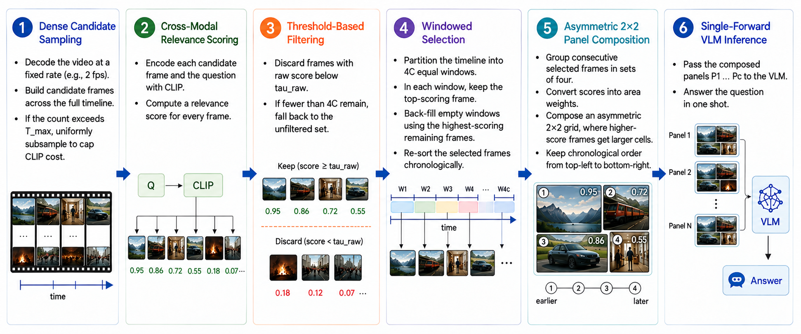
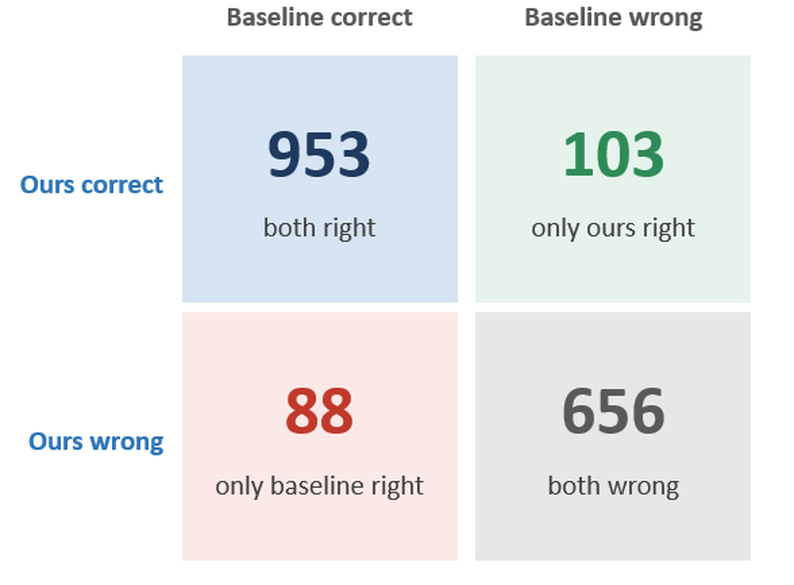
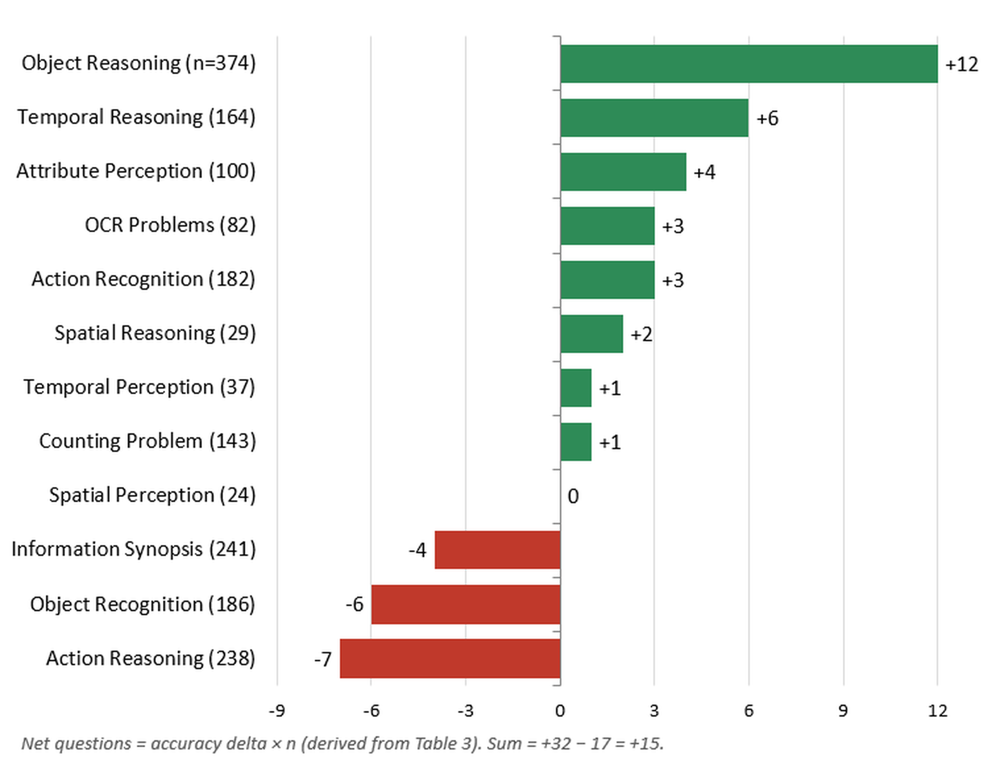
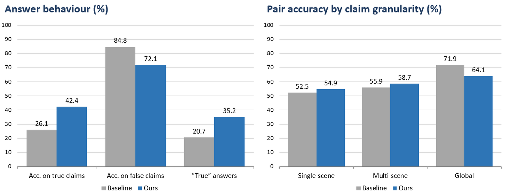
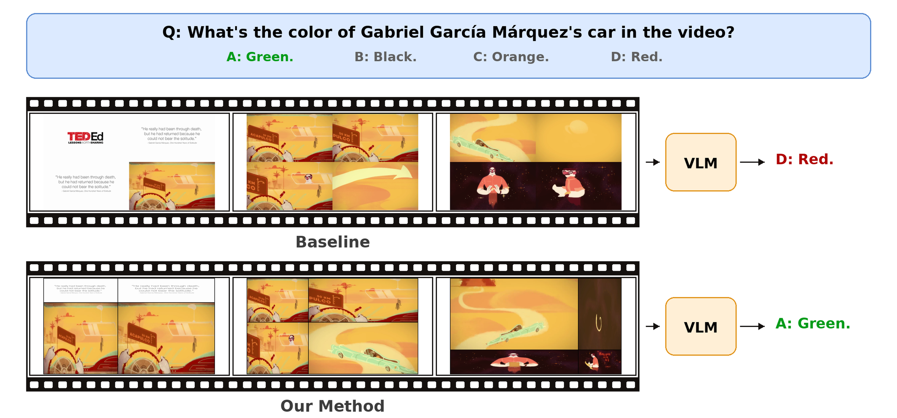
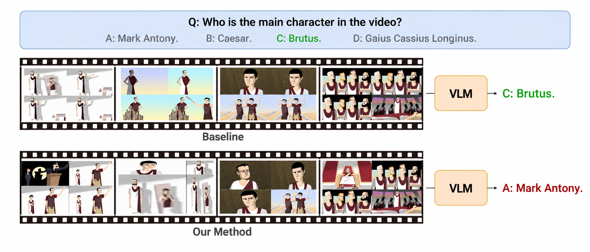
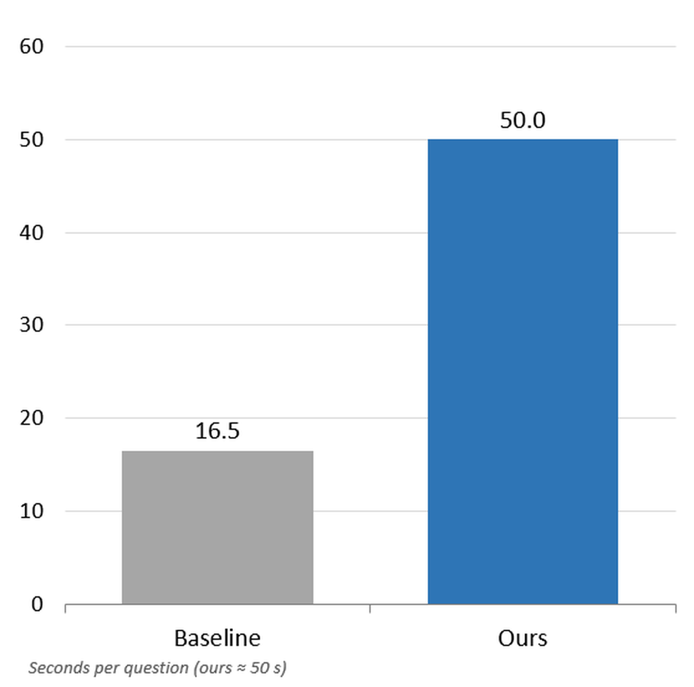

# Query-Guided Asymmetric Grid Composition: A Training-Free Approach for Long Video Understanding

**Humaira Anzum Neha, Sadman Sakib**
Department of Computer Science and Engineering, BRAC University

---

## Overview

Vision-Language Models (VLMs) answer questions about short videos well, but their accuracy drops sharply as videos get longer. The cause is a fixed **visual-token budget**. A long video has to be squeezed into that budget in one of two ways:

- **Fewer frames at full resolution:** the model sees sharp images but misses most of the timeline.
- **Many frames at low resolution:** the model covers the timeline but can no longer read a scoreboard, a caption, or a licence plate.

Existing training-free methods each solve only one side of this trade-off:

| Existing approach | What it does well | What it misses |
|---|---|---|
| **Query-aware selection** (BOLT, Q-Frame) | Picks frames relevant to the question | Sends them as separate images, with no temporal structure |
| **Video Panels** | Packs 4 frames into one 2×2 image, giving 4× temporal coverage | Uses uniform, query-blind sampling and shrinks every frame equally |
| **Multi-agent systems** (Symphony) | Handles both sides | Needs many model calls per question |

**Our idea:** spend the pixel budget *unevenly*. Frames that are relevant to the question get a large share of the canvas. Less relevant frames stay small, so temporal context survives. The method is **training-free**, **model-agnostic**, and runs in a **single forward pass**.

## Method



1. **Dense candidate sampling.** Decode the video at a fixed rate (2 fps for Video-MME), capped at `T_max` candidate frames.
2. **Cross-modal relevance scoring.** Embed every frame and the question with a frozen CLIP ViT-B/32. The relevance score is their cosine similarity.
3. **Threshold filtering.** Drop frames whose *raw* similarity is below 0.15. If too few frames remain, fall back to the full set.
4. **Windowed selection.** Split the timeline into `4C` equal windows and keep the best frame in each. This guarantees coverage of the whole video, so one high-scoring scene cannot take the whole budget.
5. **Asymmetric 2×2 composition.** Turn each group of 4 frames' scores into area weights with a sharpened softmax (temperature τ = 0.02). Set one vertical and one horizontal split so that each cell's area follows its relevance. Frames stay in chronological order from top-left to bottom-right, and splits are clamped to [0.25, 0.75] so no cell becomes unreadable.
6. **Single-pass inference.** Send the `C` canvases (1024×576 each) to the VLM together with the question.

## Results

All experiments use **Qwen2.5-VL-7B-Instruct** with `C = 32` images per question (128 frames). The baseline is our reimplementation of **Video Panels** with the same model, prompt, and frame budget.

### Video-MME (medium and long splits, no subtitles)

| Split | Video Panels | Ours | Δ |
|---|---|---|---|
| Medium (n = 900) | 62.2 | **63.3** | +1.1 |
| Long (n = 900) | 53.4 | **54.0** | +0.6 |
| **Overall (n = 1800)** | 57.8 | **58.7** | **+0.9** |

The overall gain is consistent across both splits. It is **not statistically significant** (McNemar p = 0.31). The two methods give the same answer on 84.1% of questions; where correctness differs, ours wins 103 and the baseline 88.



The breakdown by task is more informative.



- **Gains** appear where the answer sits in a specific moment: object reasoning (+12 questions), temporal reasoning (+6), attribute perception, OCR, and spatial reasoning. Enlarging the most relevant frame makes small details readable, and windowed selection keeps transitions that uniform sampling skips over.
- **Losses** appear on whole-video questions: action reasoning (−7), object recognition (−6), and information synopsis (−4). When the evidence is spread across all four cells, shrinking three of them to enlarge one removes useful information.

### MF2 (long-movie true/false claim pairs)

On MF2, a pair counts as correct only when *both* the true claim and the false claim are judged correctly, so guessing cannot score well.

| Metric | Video Panels | Ours | Δ |
|---|---|---|---|
| **Pair accuracy** | 16.9 | **23.5** | **+6.6** (p = 0.0016) |
| Claim accuracy | 55.4 | 57.3 | +1.9 |
| Accuracy on true claims | 26.1 | 42.4 | +16.3 |
| Accuracy on false claims | 84.8 | 72.1 | −12.7 |
| Share of "true" answers | 20.7 | 35.2 | +14.5 |

*455 of 868 pairs evaluated, video-only setting.*



Pair accuracy improves by **39% relative**, and the difference is statistically significant. Both systems are biased toward answering "false", which is what a model does when it cannot find supporting evidence. Query-aware selection surfaces frames that confirm true claims, which reduces this bias. Gains appear on single-scene and multi-scene claims. Global claims about the whole movie do not benefit.

### Qualitative examples

**Success:** the relevant frame receives the largest cell, and the model reads the detail correctly.



**Failure:** the relevance scores point at the wrong moment, so the enlarged cell does not contain the evidence.



### Cost



The method takes about **50 s per question, compared with 16.5 s for the baseline**. Almost all of the difference is CLIP scoring of the dense candidate frames. When several questions are asked about the same video, as in MF2, the candidate embeddings can be cached so each new question only needs one text embedding, which brings the cost close to the baseline.

## Limitations

- **Layout geometry:** a 2×2 cross-split has only two degrees of freedom. Anti-diagonal score patterns (for example, top-left and bottom-right both high) collapse to a near-uniform grid.
- **CLIP blind spots:** CLIP scores single frames, so it has no notion of motion, event order, or dialogue. This explains the weaker results on summary and global questions.
- **Run-to-run variation:** batched serving is not bit-deterministic, so the 0.9-point Video-MME gap should be treated as provisional.

## Repository contents

| File | Description |
|---|---|
| [`our_method.py`](our_method.py) | Our method: dense sampling → CLIP scoring → threshold filter → windowed selection → asymmetric 2×2 canvases |
| [`video_panels_baseline.py`](video_panels_baseline.py) | Baseline: our reimplementation of Video Panels (uniform, query-blind sampling into equal-size 2×2 cells) |
| [`evaluate_panels_mlx.py`](evaluate_panels_mlx.py) | Video-MME evaluation script with a local MLX backend (Apple Silicon). Runs either the baseline (`--method panels`) or our method (`--method ours`) |
| [`assets/`](assets) | Figures used in this README |

## Running the code

### 1. Install dependencies

Python 3.10 or newer is recommended.

```bash
pip install torch transformers opencv-python numpy pillow scipy datasets
```

To run the evaluation script locally, you also need MLX-VLM, which requires a Mac with Apple Silicon:

```bash
pip install mlx-vlm
```

`our_method.py` and `video_panels_baseline.py` on their own run on any platform. CLIP uses CUDA, Apple MPS, or CPU automatically.

### 2. Generate panels for your own video

```python
from our_method import OurMethodConfig, ClipScorer, our_method_pipeline

config = OurMethodConfig(C=8, sample_rate_fps=2.0)   # 8 canvases = 32 frames
scorer = ClipScorer()                                # loads CLIP ViT-B/32 once

canvases, meta = our_method_pipeline(
    "my_video.mp4",
    "What colour is the car?",
    scorer,
    config,
    return_meta=True,
)

for i, canvas in enumerate(canvases):
    canvas.save(f"panel_{i}.png")

print(meta[0])   # split ratios, timestamps, CLIP scores, target vs. achieved areas
```

To build the equal-size baseline panels for comparison:

```python
from video_panels_baseline import PanelConfig, video_panels_pipeline

panels = video_panels_pipeline("my_video.mp4", PanelConfig(C=8, canvas_w=1024, canvas_h=576))
```

You can pass the saved panels, together with your question, to any VLM that accepts multiple images.

Useful settings in `OurMethodConfig`:

| Setting | Default | Meaning |
|---|---|---|
| `C` | 16 | Number of canvases. Each holds 4 frames, so `4C` frames are selected |
| `sample_rate_fps` | 1.0 | Candidate sampling rate (2.0 was used for Video-MME) |
| `max_candidates` | 1024 | Maximum number of frames scored by CLIP |
| `raw_score_threshold` | 0.15 | Frames below this raw CLIP similarity are dropped |
| `selection_strategy` | `"windowed"` | `"windowed"` (best frame per time window) or `"topk"` (for ablation) |
| `softmax_temperature` | 0.02 | Lower values give stronger size differences between cells |

### 3. Evaluate on Video-MME (Apple Silicon)

1. Download the Video-MME videos.
2. Set `VIDEO_DATA_DIR` and `HF_CACHE_DIR` at the top of `evaluate_panels_mlx.py` to your local paths. The temporary panel folder (`/Volumes/TRANSCEND/tmp`) is also hardcoded inside `main()`; change it as well.
3. Run:

```bash
# Quick smoke test on 5 questions
python evaluate_panels_mlx.py --method ours --limit 5 --C 4

# Our method, configuration used for the reported results
python evaluate_panels_mlx.py --method ours --duration medium --C 32 --sample-rate 2.0
python evaluate_panels_mlx.py --method ours --duration long   --C 32 --sample-rate 2.0

# Video Panels baseline (uniform sampling, gamma = 1)
python evaluate_panels_mlx.py --method panels --duration medium --C 32 --gamma 1.0 --match-canvas
python evaluate_panels_mlx.py --method panels --duration long   --C 32 --gamma 1.0 --match-canvas

# Save the generated panels to inspect what the model saw
python evaluate_panels_mlx.py --method ours --limit 5 --save-panels
```

`--match-canvas` makes the baseline output the same 1024×576 canvas as our method, so both send the same number of visual tokens per image and the comparison isolates frame selection and layout.

Results are written to `results_panels_mlx.jsonl` (one line per question, including task category), and overall accuracy is printed at the end. (The script's closing message mentions `analyze_failures.py`, a separate analysis helper that is not part of this repository.) Run `python evaluate_panels_mlx.py --help` to see all options, such as `--selection topk`, `--softmax-temperature`, `--score-threshold`, and the `--no-visual` text-only diagnostic.

> **Note:** The reported results were produced with Qwen2.5-VL-7B-Instruct served through an OpenAI-compatible API. The MLX backend here runs a 4-bit quantised version of the same model and was used during development, so its numbers may differ slightly.

## License

This project is released under the terms in [LICENSE](LICENSE).
